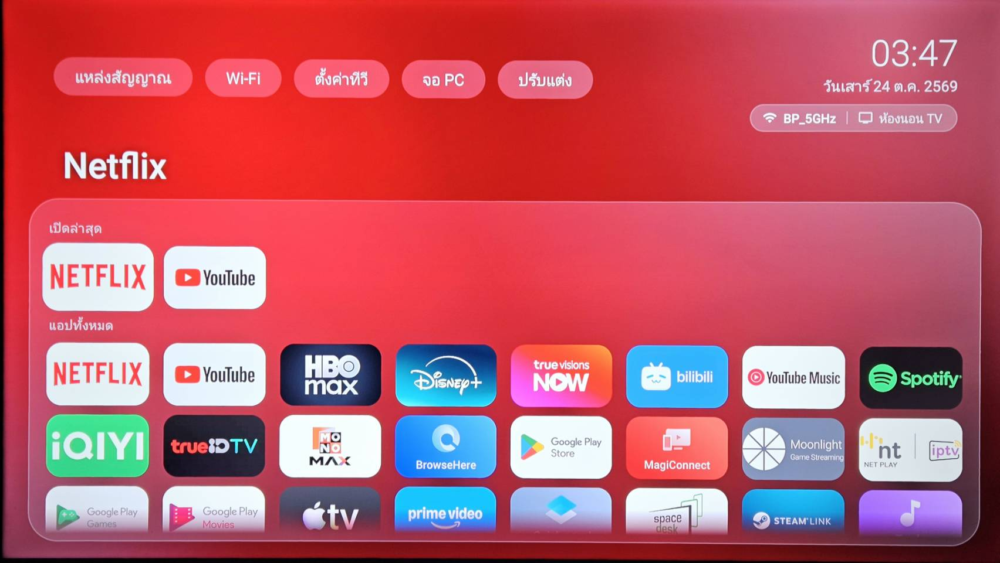

# divlab TV Launcher

Launcher สำหรับ Android TV / Google TV — เบา สวย แนว Apple TV ไม่มีโฆษณา · by [divlab.co](https://divlab.co)



## ฟีเจอร์
- พื้นหลัง gradient glass ดึงสีจากแอปที่เลือก
- แถว **เปิดล่าสุด** — กดกลับไปดูต่อได้ทันที
- นาฬิกา + วันที่ภาษาไทย (พ.ศ.), ชื่อทีวี, Wi-Fi/LAN ที่เชื่อมอยู่
- ปุ่มลัด: แหล่งสัญญาณ · Wi-Fi · ตั้งค่าทีวี · จอ PC
- จัดเรียงแอป (กดค้าง OK → ย้ายตำแหน่ง → ลูกศร → OK) และซ่อนแอป
- หน้า **ปรับแต่ง** (ใช้ ◀ ▶ เปลี่ยนค่า): รูปทรงไอคอน 4 แบบ, ขนาดไอคอน, จำนวนคอลัมน์, ชื่อใต้ไอคอน, สีพื้นหลัง, เปิด/ปิดปุ่มจอ PC ฯลฯ
- **แทนที่ปุ่ม Home** ของรีโมต
- **อัปเดตในแอป** จาก GitHub Releases
- **พักหน้าจอ** นาฬิกาเต็มจอ + สีเคลื่อนไหว (หรี่ลงตอนกลางคืน, ขยับกัน burn-in)
- **ตั้งเวลาปิดทีวี** 15 นาที – 2 ชั่วโมง
- **ธีมสี** 6 ชุด (Aurora, Midnight, Sunset, Ocean, Forest, Rose) หรือสีตามแอป
- **สภาพอากาศ** ข้างวันที่ (Open-Meteo, ไม่ต้องใช้ API key)
- ภาษา **ไทย / English**
- หน้า **แนะนำการใช้งานครั้งแรก** พาไปเปิดสิทธิ์ต่าง ๆ
- ไม่มี background service ที่กินแรง, APK เล็ก

## อุปกรณ์ที่ทดสอบแล้ว

| อุปกรณ์ | ระบบ | ผล |
|---|---|---|
| TCL 55C635 | Android TV 11 (Google TV) | ✅ ใช้งานได้ทุกฟีเจอร์ |

ทดสอบบนเครื่องอื่นแล้ว? เปิด [Issue](https://github.com/divlabco/divlab-tv-launcher/issues) บอกรุ่นทีวีและผลได้เลย

> **หมายเหตุ TCL:** เมนูการช่วยเหลือพิเศษถูกซ่อน — ใช้คำสั่ง adb ในวิธีที่ 2 ข้อ 4 ครั้งเดียว แล้วเปิด/ปิด "แทนที่ปุ่ม Home" ในแอปได้เลย

---

## ติดตั้ง — วิธีที่ 1: บนทีวีอย่างเดียว (ไม่ต้องใช้คอม)

1. บนทีวีติดตั้งแอป **Downloader** (by AFTVnews) จาก Play Store
2. ตั้งค่า → ระบบ/ความปลอดภัย → **ติดตั้งแอปที่ไม่รู้จัก** → เปิดให้ Downloader
3. เปิด Downloader แล้วพิมพ์ลิงก์ ↓ → ติดตั้ง

```
https://github.com/divlabco/divlab-tv-launcher/releases/latest/download/divlab-launcher.apk
```

หรือสแกน QR ด้วยมือถือเพื่อดาวน์โหลด: <br>


4. เปิด **divlab Launcher** จากรายการแอป → **ปรับแต่ง → แทนที่ปุ่ม Home**
   (ถ้าทีวีไม่มีเมนูการช่วยเหลือพิเศษ ให้ใช้วิธีที่ 2 ข้อ 4)

## ติดตั้ง — วิธีที่ 2: ผ่าน adb (จากคอมพิวเตอร์)

**1. เปิด debug บนทีวี**
ตั้งค่า → ระบบ → เกี่ยวกับ → กด *Android TV OS build* 7 ครั้ง → กลับไปที่ ตั้งค่า → ระบบ → ตัวเลือกสำหรับนักพัฒนา → เปิด **USB debugging** (และ Network debugging ถ้ามี) แล้วดู IP ทีวีที่ ตั้งค่า → เครือข่าย

**2. ติดตั้ง adb**
```bash
# macOS
brew install android-platform-tools
# Windows: winget install Google.PlatformTools
# Linux:   sudo apt install adb
```

**3. เชื่อมต่อและติดตั้ง** (กด *Allow* บนทีวีตอนเชื่อมครั้งแรก)
```bash
TV=192.168.1.xx:5555          # ← IP ทีวีของคุณ
adb connect $TV
curl -LO https://github.com/divlabco/divlab-tv-launcher/releases/latest/download/divlab-launcher.apk
adb -s $TV install -r divlab-launcher.apk
```

**4. ให้สิทธิ์ (ครั้งเดียว)**
```bash
# ให้ launcher เปิด/ปิด "แทนที่ปุ่ม Home" เองได้จากหน้าปรับแต่ง
adb -s $TV shell pm grant co.divlab.tvlauncher android.permission.WRITE_SECURE_SETTINGS
# ให้อัปเดตจากในแอปได้
adb -s $TV shell appops set co.divlab.tvlauncher REQUEST_INSTALL_PACKAGES allow
# ให้แสดงชื่อ Wi-Fi ได้
adb -s $TV shell pm grant co.divlab.tvlauncher android.permission.ACCESS_FINE_LOCATION
```

**5. เปิดแทนที่ปุ่ม Home** — กดในแอป (ปรับแต่ง → แทนที่ปุ่ม Home) หรือสั่งตรง:
```bash
adb -s $TV shell settings put secure enabled_accessibility_services co.divlab.tvlauncher/co.divlab.tvlauncher.HomeOverrideService
adb -s $TV shell settings put secure accessibility_enabled 1
```

**(ไม่บังคับ) ปิดหน้า Home เดิมให้สะอาดสุด** — ไม่เห็นหน้า Google TV แวบเลย
```bash
adb -s $TV shell pm disable-user --user 0 com.google.android.apps.tv.launcherx
adb -s $TV shell pm disable-user --user 0 com.google.android.tungsten.setupwraith
# กลับไปใช้ของเดิม: เปลี่ยน disable-user --user 0 เป็น enable
```

**อัปเดต:** ปรับแต่ง → อัปเดต (ในแอป ต้องเป็น v0.8.1 ขึ้นไป) หรือ `adb -s $TV install -r divlab-launcher.apk` ด้วยไฟล์ใหม่

**ถอนการติดตั้ง:**
```bash
adb -s $TV shell settings delete secure enabled_accessibility_services
adb -s $TV shell pm enable com.google.android.apps.tv.launcherx
adb -s $TV uninstall co.divlab.tvlauncher
```

---

## สำหรับนักพัฒนา
- Kotlin + Android Views (minSdk 26), ไม่ใช้ Compose/Leanback เพื่อให้เบาบนทีวี RAM น้อย
- Push ไป `main` → GitHub Actions build APK, push tag `v*` → สร้าง Release
- `bash push.sh v0.x.y` = push + รอ build + ติดตั้งลงทีวี, เพิ่ม `--no-install` เพื่อปล่อย Release อย่างเดียว
- APK เซ็นด้วย secret `KEYSTORE_BASE64` + `KEYSTORE_PASSWORD` (alias `divlab`) เพื่อให้อัปเดตทับกันได้

## License
MIT © divlab.co
